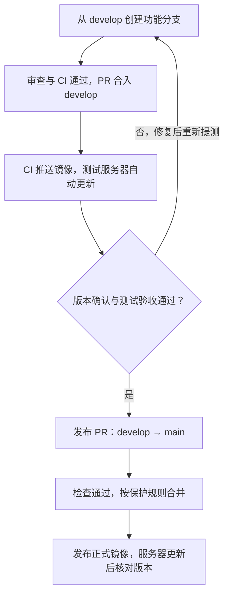

# ModelSphere 官网开发与发布规范

适用仓库：`modelsphere/modelsphere-website`。代码、文案、博客、图片和翻译统一遵循本流程。



## 1. 分支与环境

| 分支                                  | 用途               | 提交与合并规则                                           | 合并后的自动行为                                 |
| ------------------------------------- | ------------------ | -------------------------------------------------------- | ------------------------------------------------ |
| `feat/*`、`fix/*`、`docs/*`、`i18n/*` | 开发单个需求或问题 | 从最新 `develop` 创建，通过 PR 合入 `develop`            | 分支和 PR 执行 CI 检查                           |
| `develop`                             | 团队集成和测试     | 所有改动先通过 PR 合入，不直接 push                      | 检查通过后推送测试镜像，服务器随后自动拉取并部署 |
| `main`                                | 正式发布           | 受保护分支；发布 PR 固定为 `develop → main`，不手动 push | 检查通过后发布 HTTPS 正式镜像                    |

测试环境为内网网站的 `40211` 端口；服务器地址及访问方式由团队维护。正式环境为 [modelsphere.tech](https://modelsphere.tech/)。

## 2. 开发与提测

| 步骤         | 负责人         | 操作                                     | 完成标准                             |
| ------------ | -------------- | ---------------------------------------- | ------------------------------------ |
| 开始开发     | 开发者         | 更新本地 `develop`，创建功能分支         | 分支基于最新 `origin/develop`        |
| 提交 PR      | 开发者         | `功能分支 → develop`，描述改动和测试方法 | 本地检查通过，PR 目标分支正确        |
| 审查与合并   | 审查者、合并者 | 检查代码、影响范围及 CI 后合并           | PR 检查通过，审查意见处理完毕        |
| 等待测试部署 | 开发者         | 跟进合并提交的 Actions 和服务器版本      | 镜像发布成功，测试站显示目标提交 SHA |
| 测试验收     | 开发者、验收者 | 在测试站验证本次改动及相关页面           | 记录验收范围、结果和实际验收 SHA     |

功能分支建议采用 `feat/功能名`、`fix/问题名`、`docs/主题`、`i18n/语言与主题`。一个 PR 尽量对应一项完整改动，包含必要的代码、测试、文案、翻译及图片。

未完成的改动保留在功能分支或 Draft PR；`develop` 是共享测试环境，不为每个功能分支生成独立部署。自己的 PR 合并后，提交人负责跟进部署和验收结果。

## 3. 何时算测试环境更新完成

| 状态                                                  | 含义                     | 能否开始正式验收     |
| ----------------------------------------------------- | ------------------------ | -------------------- |
| 功能 PR 的 CI 通过                                    | 该 PR 的候选代码检查通过 | 等待合并及测试部署   |
| `develop` 合并提交的镜像发布成功                      | 阿里云已有新镜像         | 等待服务器拉取并切换 |
| 测试站 `/version.json` 与目标 `develop` 提交 SHA 一致 | 测试环境已经运行目标代码 | 可以验收             |

镜像发布后，服务器通常还需几分钟完成检查、拉取和切换。**以实际版本为准，不以等待时间、镜像标签名或 Actions 总体绿勾判断测试环境已更新。**

确认方法：

1. 在 `develop` 合并提交对应的 Actions 中，确认 **Publish develop image to Aliyun ACR** 成功。
2. 展开 **Verify published image manifests**，找到 `sha-<完整提交 SHA>` 标签。
3. 打开测试站 `http://服务器IP:40211/version.json`，确认 `commit` 与该 SHA 一致。

测试服务器本机也可以执行：

```sh
curl --noproxy '*' -fsS http://127.0.0.1:40211/version.json
```

固定的 `:develop` 标签会指向新的镜像；固定版本使用 `:sha-<完整提交 SHA>`。只看容器使用了 `:develop` 标签，无法确定它是否已更新。

验收至少覆盖本次变更、受影响页面及主要操作。涉及中英文、浅深主题、移动布局或图片时，验证对应场景；发现问题后回到功能分支修复，通过新的 PR 合入 `develop`，再等待新版本并重新验收。

## 4. 正式发布

| 步骤         | 负责人             | 操作                                                       | 完成标准                                         |
| ------------ | ------------------ | ---------------------------------------------------------- | ------------------------------------------------ |
| 确定发布范围 | 发布负责人         | 汇总本次发布的 PR，确定已验收的 `develop` 提交 SHA         | 本次范围内所有改动已验收                         |
| 创建发布 PR  | 发布负责人         | `base: main`、`compare: develop`                           | PR 描述包含改动列表、测试地址、验收 SHA 和结果   |
| 发布审查     | 审查者、发布负责人 | 检查完整发布差异、CI 和验收记录                            | 满足分支保护规则，发布范围没有未验收内容         |
| 合并发布     | 有合并权限的成员   | 在 GitHub 合并 `develop → main`                            | 不直接 push、强制 push 或绕过保护规则            |
| 上线确认     | 发布负责人         | 跟进 **Publish production image to Aliyun ACR** 并检查主站 | 主站版本与本次 `main` 合并提交一致，关键页面正常 |

**推荐发布期间暂停向 develop 合入其他 PR。** 若创建发布 PR 后 `develop` 又有新提交，原验收不能自动覆盖新提交；必须确认新差异并对新的目标版本重新验收后，才能合并发布。

发布 PR 会包含 `develop` 相对 `main` 的全部待发布改动，不能只看最后一个功能 PR。若其中有未准备上线的功能，应先协调移除或修正，再对最终版本重新验收。

`develop → main` 发布 PR 统一使用 **Create a merge commit**，保留两个长期分支的历史关系，不删除 `develop`。功能分支 PR 可按仓库约定整理提交，合并后删除已经完成的功能分支。

主站可以通过 [version.json](https://modelsphere.tech/version.json) 核对版本。测试站应与验收时的 **develop SHA** 比较，主站应与本次发布的 **main SHA** 比较；两次合并产生的 SHA 可以不同。

正式镜像与测试镜像位于同一 ACR 仓库。正式服务器跟踪 `:production`，回滚可使用 `:production-sha-<完整 main SHA>`。服务器安装与验收见[正式服务器部署](infra/deploy/README.md)。

## 5. PR 中写什么

功能 PR 至少写明：改了什么、为什么改、影响哪些页面、如何验证，以及本地验证结果；界面变更附必要截图。

发布 PR 建议标题为 `release: YYYY-MM-DD 官网更新`，描述使用以下内容：

```text
发布内容：关联的功能 PR 和主要改动
测试地址：http://服务器IP:40211
已验收 develop SHA：完整提交 SHA
验收结果：验证人、验证范围、结果
发布确认：当前 develop 与已验收 SHA 一致，或新增提交已重新验收
```

验收记录写在对应 PR 的描述或评论中，方便其他人确认。正式上线后，由发布负责人在发布 PR 留下实际 `main` SHA、部署结果和主站验证结果。

## 6. 更新失败与修复

| 问题                           | 处理方式                                                                                                                    |
| ------------------------------ | --------------------------------------------------------------------------------------------------------------------------- |
| PR 或合并提交 CI 失败          | 开发者检查失败日志并修复；失败的候选不视为已经提测或上线                                                                    |
| 镜像已发布，但测试站版本未变化 | 检查测试服务器的自动更新日志，不反复合并无关提交触发发布                                                                    |
| 测试验收未通过                 | 修复后重新合入 `develop`，确认新版本后再验收                                                                                |
| 正式发布失败                   | 发布负责人先核对主站实际版本和 Actions 失败步骤；基础设施暂态故障可重试对应失败任务，代码问题走修复流程                     |
| 上线后发现问题                 | 新建修复或撤销改动的功能 PR，先合入 `develop` 验收，再通过 `develop → main` 发布；不直接修改服务器静态文件或强制重写 `main` |

测试服务器的排查命令：

```sh
systemctl status modelsphere-website-update.timer --no-pager -l
journalctl -u modelsphere-website-update.service -n 60 --no-pager
```

## 7. 团队约定与自动约束

现有流水线已区分 `develop` 测试镜像与 `main` 主站部署，`main` 的保护规则要求通过 PR 合并。本文进一步约定功能 PR 的目标分支、验收记录和发布顺序，需要提交人、审查者和发布负责人共同遵守。

建议维护者将 PR 的必要 CI 检查设为必需状态检查，并为两个长期分支禁止直接 push。若需自动阻止非 `develop` 分支向 `main` 发起发布，可增加来源分支检查并设为必需检查。当前规则未自动验证测试站验收记录或要求固定的人工审批人数，不能把文档约定视作已经启用的自动拦截。
