> 面向无法联网的安全隔离机房，ModelSphere 提供 Kubernetes 离线部署方案。本文以 4 台昇腾 910B4 服务器为例，带你走通从离线备料、集群搭建到控制台部署 GLM-5.3-Flash 四副本服务的流程，并完成调用验证。

ModelSphere 项目开源后，社区反馈了一类私有化部署需求：团队希望在自己的昇腾环境中运行模型，其中一些机房出于安全考虑采用内外网隔离、无法连接外网。

**联网环境可直接沿用 ModelSphere 常规部署流程；针对这类不能联网的隔离场景，ModelSphere 专门提供了基于 Kubernetes 的离线部署方案。** 先在联网环境中把集群基础工具、平台组件镜像、Helm chart、模型目录快照以及推理引擎镜像和模型权重准备齐全，再将这些物料带入机房完成安装。

进入机房后，容器镜像从本地镜像仓库拉取，组件通过本地 Helm chart 安装，控制台直接读取集群内的模型目录服务。部署依赖都在内网获取，后续即可通过网页控制台创建模型服务、接入统一网关，并管理副本扩缩和版本升级。

下面就以 4 台昇腾 910B4 服务器为例，从联网准备离线物料开始，一步步搭建这套环境，再基于 GLM-5.3-Flash（W8A8）配方部署四个独立副本，验证模型能否通过统一入口正常返回回答。

## 01 先看清整条部署链路

整个部署过程分为三个操作位置：**联网构建机负责准备物料，机房运维机负责初始化节点，4 台昇腾服务器负责运行 Kubernetes、ModelSphere 平台与模型服务。**

| 操作位置       | 承担的工作                                                                                                      |
| -------------- | --------------------------------------------------------------------------------------------------------------- |
| 联网构建机     | 下载集群基础工具，打包平台组件镜像、Helm chart 与模型目录快照；再单独下载模型引擎镜像，并准备模型权重与运维依赖 |
| 机房运维机     | 通过 SSH 与 Ansible 初始化 4 台昇腾服务器，可由机房内一台 Linux 主机承担                                        |
| 4 台昇腾服务器 | 服务器 1 兼任控制面、本地镜像仓库与模型计算节点；其余 3 台承担模型计算，每台运行一个 8 卡 TP=8 副本             |

将项目代码、离线目录、运维依赖和模型权重带入机房后，部署按「建立本地仓库与 Kubernetes 集群 → 安装网络插件、昇腾设备插件与 ModelSphere 平台 → 控制台选配方部署模型」的顺序展开：

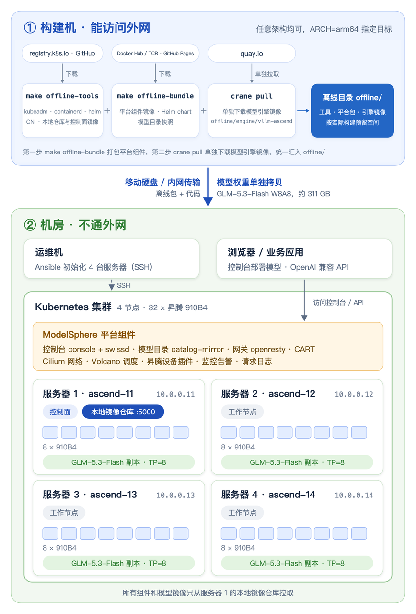

_图：4 台服务器共配备 32 张昇腾 910B4，每个模型副本使用一台服务器的 8 张卡。联网构建机按两步流程分别准备平台组件物料与推理引擎镜像，再连同项目代码和模型权重带入机房；磁盘空间按实际构建与下载大小预留。_

需要说明的是，本文采用**单控制面的精简四机拓扑**，目的是用较少服务器跑通整条离线部署链路。如果用于高可用生产环境，需要在此基础上做两项规划：一是另行准备三个独立控制面节点，并考虑本地镜像仓库的可用性；二是配置持久化存储——本文监控组件默认使用临时存储，Pod 重建或迁移后，其中的监控指标、Grafana 配置和告警静默状态会丢失，需要长期保留这些数据时应按仓库文档启用持久化存储。下面聚焦这套四机拓扑，逐项展开安装步骤。

## 02 准备服务器环境与运维工具

开始打包之前，先核对机房内 4 台昇腾服务器的基础配置，并把构建机、运维机和目标节点所需的依赖准备齐全。

### 硬件规格、示例地址与目录约定

| 检查项        | 本次配置与准备要点                                                                                                         |
| ------------- | -------------------------------------------------------------------------------------------------------------------------- |
| 计算节点      | 4 台 aarch64 架构服务器，每台配备 8 × 昇腾 910B4（单卡 64 GB HBM）                                                         |
| 操作系统      | 本次部署环境采用麒麟 V10；若使用其他 aarch64 Linux 发行版，需提前核对 NPU 驱动、运行时与内核兼容性                         |
| 内核与 cgroup | 准备 Linux 5.10 或更新内核，并开启 cgroup v2                                                                               |
| CPU 与内存    | 当前模型配方每副本申请 32 CPU、64 GiB 内存；考虑到权重加载峰值、系统页缓存及平台组件开销，建议每台主机至少配备 256 GB 内存 |
| 磁盘空间      | 每台服务器保存一份数百 GB 的模型权重，并为引擎缓存和日志留出空间；服务器 1 还需额外存放离线包与导入后的本地镜像仓库        |
| 网络连通      | 四台服务器内网互通；运维机可通过 SSH 访问各节点；浏览器与业务客户端能访问对应服务端口                                      |

关于内存和磁盘有两点需要留意：配方中的 `64 GiB` 内存用于 Kubernetes 调度判断，主机所需的实际内存还要覆盖权重加载过程的页缓存开销；本次使用的 GLM-5.3-Flash W8A8 权重约 311 GB，规划磁盘时应以下载目录的实际大小为基础，再叠加镜像解包、本地仓库和运行缓存所需的空间。

下文命令采用以下示例地址与目录，实际操作时请统一替换为现场规划：

| 节点名    | 示例 IP   | 节点角色                           |
| --------- | --------- | ---------------------------------- |
| ascend-11 | 10.0.0.11 | 控制面、本地镜像仓库、NPU 工作节点 |
| ascend-12 | 10.0.0.12 | NPU 工作节点                       |
| ascend-13 | 10.0.0.13 | NPU 工作节点                       |
| ascend-14 | 10.0.0.14 | NPU 工作节点                       |

其中，本地镜像仓库使用 `10.0.0.11:5000`，项目仓库统一放在 `/root/modelsphere`，模型权重统一放在 `/data/models/zai-org/GLM-5.3-Flash`。

### 在每台昇腾服务器上检查驱动、内核与 cgroup

分别登录四台昇腾服务器，执行以下命令核对基础环境：

```bash
npu-smi info
uname -r
stat -fc %T /sys/fs/cgroup
```

确认 `npu-smi` 能正常识别 8 张 NPU，且 cgroup 文件系统输出为 `cgroup2fs`。实测中，麒麟 V10 默认的 4.19 内核曾遇到网络插件 Cilium 启动问题，因此本篇采用升级至 5.10 或更新内核的准备路径；具体发行版的回移支持以 [Cilium 系统要求](https://docs.cilium.io/en/stable/operations/system_requirements/)为准。需要开启 cgroup v2 时，由主机管理员添加内核启动参数 `systemd.unified_cgroup_hierarchy=1`，重启后再次检查确认生效。

此外，每台服务器还需提前安装兼容的昇腾 NPU 驱动、固件及 `ascend-docker-runtime`。后续初始化节点时，脚本会将昇腾运行时注册到 containerd，供容器调用 NPU。

### 提前备好构建机工具与运维机 Ansible 依赖

离线部署除了准备集群与模型物料，还需要提前备齐构建机、运维机和目标节点的运行依赖：

- **联网构建机**：需要安装 `git`、`make`、带 PyYAML 的 Python、Helm、Helmfile 和 `crane`。构建机可以是 x86 架构，打包时通过 `ARCH=arm64` 指定目标架构即可。
- **机房运维机**：需要准备 Ansible 以及 `community.general`、`ansible.posix` 两个集合。ModelSphere 基础工具包提供的是集群安装工具，Ansible 运行环境需要单独准备，因此**这些依赖需在进入离线机房前准备就绪**。已有联网运维环境可先安装并验证：

```bash
ansible-galaxy collection install community.general ansible.posix
ansible --version
ansible-galaxy collection list
```

如果运维机始终处于纯内网环境，应提前在联网侧准备好 Ansible、Python 及上述集合的离线安装物料，带入机房在运维机上安装并验证可用。

**昇腾节点上的 Python 兼容处理**：Ansible 控制机与目标节点所需的 Python 版本随 `ansible-core` 版本变化，可按 [Ansible 支持矩阵](https://docs.ansible.com/projects/ansible/latest/reference_appendices/release_and_maintenance.html)核对匹配。若麒麟系统自带的 Python 不满足所选版本要求，保留系统 Python 供 CANN 和 `npu-smi` 使用，另行准备一个供 Ansible 调用的独立 Python：提前下载匹配系统的 `python-build-standalone`（aarch64 `install_only` 包）随物料带入机房。若目标服务器已有兼容的 Python，后续在 `inventory.ini` 中改为实际路径即可。

## 03 在联网构建机制作离线包

环境要求核对清楚后，在联网构建机上制作离线物料。整个过程分为获取代码、下载基础工具、打包平台组件，以及单独下载模型引擎镜像。

### 获取本篇对应的项目代码

先拉取 ModelSphere 仓库并切换到本文使用的固定提交，便于对照后文的脚本和参数：

```bash
git clone https://github.com/modelsphere/modelsphere.git
cd modelsphere
git checkout 3c3e45d06d48aadaa9b770f7d01ddc5c42cb7eb2
```

后续打包命令均在该项目目录中执行。构建完成后，还应保存实际生成的模型目录快照、镜像清单和 `MANIFEST` 文件，用于入场时核对本次离线物料。

需要使用国内镜像源时，可在打包前设置下载映射（按当前网络选择可达的源）：

```bash
export BUNDLE_FETCH_MIRRORS="docker.io/4pdosc=modelsphere.tencentcloudcr.com/4pdosc docker.io=docker.m.daocloud.io registry.k8s.io=k8s.m.daocloud.io"
```

配置映射只改变下载拉取的来源地址，离线包内部仍按原始镜像引用记录物料，不影响后续部署时的导入与改写。

### 下载基础工具与控制面镜像

执行以下命令，为 arm64 目标节点下载基础二进制与控制面镜像：

```bash
ARCH=arm64 make offline-tools
```

这一步会准备 `kubeadm`、`kubelet`、`kubectl`、`containerd`、`runc`、CNI 工具，以及 Helm、Helmfile、`crane`、`nerdctl`、本地仓库镜像与 Kubernetes 控制面镜像等。完成后检查脚本输出的缺项与架构检查报告，确认所需工具齐全、目标架构可用。

### 第一步：打包平台组件镜像、chart 与模型目录

基础工具准备好后，先打包 ModelSphere 平台组件及安装所需的本地 Helm chart、模型目录快照：

```bash
ARCH=arm64 make offline-bundle \
  ARGS="--set llmGateway.node=ascend-11 --set llmGateway.hostPath=/data/bodylog-sinks --set enabled.ascendDevicePlugin=true \
       --set enabled.gpuOperator=false --set enabled.dcgmCustomMetrics=false \
       --set enabled.networkOperator=false --set enabled.nicClusterPolicy=false"
```

其中，`llmGateway` 两项确定请求日志落盘的节点与目录；`enabled.ascendDevicePlugin=true` 纳入昇腾设备插件；最后四项关闭本篇全昇腾集群用不到的 NVIDIA 相关组件。

这一步准备的是平台安装物料，运行模型所需的推理引擎镜像在下一步单独下载。打包结果主要包括：

```text
offline/
  tools/                    集群工具与控制面镜像
  images/                   平台组件镜像
  charts/                   本地 Helm chart
  catalog-snapshot.tar.gz   模型目录与引擎 chart 快照
  MANIFEST                  本次平台打包记录
```

`catalog-snapshot.tar.gz` 保存了模型配方与引擎 chart 配置，供后续集群内的控制台读取；对应的引擎容器镜像按下面一步单独准备。

### 第二步：单独下载模型推理引擎镜像

本篇使用 `glm-5.3-flash` 下的 `vllm-tp8-910b4-baseline` 配方。操作前先核对离线快照中该变体的 `image.repository` 与 `image.tag`，再将完整镜像引用交给 `crane` 下载。

下面的命令对应本文使用的 1.0.3 版本配方，通过镜像摘要（digest）固定 vLLM-Ascend 版本：

```bash
mkdir -p offline/engine
ENGINE_IMAGE='quay.io/ascend/vllm-ascend:pinned@sha256:7859b75177884252d2b703eff727831ccab4e33a8bde0a9b4ac7563facc98b33'
crane pull --format=oci "$ENGINE_IMAGE" offline/engine/vllm-ascend
```

下载后的引擎镜像保存在 `offline/engine/vllm-ascend`，随平台物料一起带入机房。如果实际快照采用了其他镜像版本，应同步更换这里的下载引用和第 04 节的推送目标。

**下载、推送与配方中的镜像引用需要保持一致。** 本篇镜像通过摘要固定版本，因此下载时保留完整的 OCI 镜像索引，推送到本地仓库后仍可按同一摘要访问；如果只保留单架构内容而改变了索引，摘要值也会随之变化。对于其他仅按标签（tag）引用的镜像，可在确认支持 arm64 后，使用 `--platform linux/arm64` 下载目标架构镜像。

### 单独准备权重并核对入场物料清单

本篇使用 `Eco-Tech/GLM-5.3-Flash-w8a8` 量化权重。请提前从对应模型源下载完整文件，核对其格式与配方要求一致，再将权重单独带入机房。准备带进机房的物料清单如下：

- 当前版本的整个 `modelsphere` 项目目录及完整的 `offline/` 目录（确认平台镜像所在的 `offline/images/` 和单独下载的 `offline/engine/vllm-ascend` 均已准备完成）；
- 模型权重文件、下载来源及文件校验记录；
- Ansible、集合及 Python 等运维依赖（使用独立 Python 时携带对应 aarch64 安装包）；
- 本次平台构建生成的 `MANIFEST`、目录快照和镜像清单，以及单独下载的引擎镜像引用、摘要与文件校验记录。

传输进机房后先核对文件校验值，确认无误后再开始下面的离线安装。

## 04 在机房初始化节点与本地仓库

物料进场后，先将代码、权重和运行环境分发到位，初始化四台节点，并在服务器 1 上建立本地镜像仓库。

### 放好代码、权重与独立 Python

将项目与离线目录复制到四台服务器的 `/root/modelsphere` 下，同时在每台服务器放好同一份模型权重，目录路径统一为：

```text
/data/models/zai-org/GLM-5.3-Flash/
```

由于控制台配方使用 `zai-org/GLM-5.3-Flash` 作为模型路径标识（后续按 `/data/models/{{name}}` 展开寻找权重），因此需要将前面下载的 W8A8 权重放入这个目录。

采用独立 Python 时，在每台服务器的安装包所在目录执行解压并检查版本（确保通配符仅匹配本次选定的安装包）：

```bash
mkdir -p /opt/ansible-python
tar -xzf cpython-*-aarch64-unknown-linux-gnu-install_only.tar.gz \
  -C /opt/ansible-python --strip-components=1
/opt/ansible-python/bin/python3 --version
```

### 在运维机配置免密 SSH 与 Ansible 清单

登录运维机进入项目目录，先配置到四台服务器的免密 SSH（首次连接按现场主机指纹核验），再基于示例生成 `inventory.ini`：

```bash
for h in 10.0.0.11 10.0.0.12 10.0.0.13 10.0.0.14; do
  ssh-copy-id root@"$h"
done
cp inventory-ascend.ini.example inventory.ini
```

编辑 `inventory.ini`，填入四台节点的地址与配置；若示例文件中带有不可用的外网代理配置，请一并移除或改为现场可用代理：

```ini
[ascend]
ascend-11 ansible_host=10.0.0.11
ascend-12 ansible_host=10.0.0.12
ascend-13 ansible_host=10.0.0.13
ascend-14 ansible_host=10.0.0.14

[ascend:vars]
k8s_install_method=binary
k8s_version=v1.36.3
k8s_accel_runtime=ascend
ansible_python_interpreter=/opt/ansible-python/bin/python3

[all:vars]
ansible_user=root
```

随后在运维机上依次执行两条命令，完成离线工具安装与节点初始化：

```bash
ansible -i inventory.ini ascend -m shell \
  -a 'cd /root/modelsphere && make offline-install-tools'
make setup-k8s-offline
```

第一条命令在各节点安装 kubeadm、containerd 等离线基础工具；输出末尾如果出现 `REGISTRY unset` 提示可以暂先忽略，下一步配置本地仓库时会统一设置仓库地址与 pause 镜像。第二条命令负责配置 `/etc/hosts`、关闭 swap、加载内核模块、设置 sysctl 和 containerd，并将昇腾运行时注册到 containerd。

### 在服务器 1 启动本地仓库并导入两类镜像

登录服务器 1，启动本地镜像仓库，并按两步流程分别导入平台镜像与引擎镜像：

```bash
cd /root/modelsphere
DATA=/data/offline-registry make offline-registry REGISTRY=10.0.0.11:5000
make offline-load REGISTRY=10.0.0.11:5000
crane push offline/engine/vllm-ascend \
  10.0.0.11:5000/vllm-ascend:pinned --insecure
crane digest 10.0.0.11:5000/vllm-ascend:pinned --insecure
```

本地仓库监听 `5000` 端口，数据存放在 `/data/offline-registry`：先用 `offline-load` 将控制面与平台组件镜像推入仓库，再用 `crane push` 单独推入模型引擎镜像。引擎在本地仓库中的名称固定为 `vllm-ascend`，与控制台改写后的镜像路径对应。

最后通过 `crane digest` 核对本地镜像摘要，确认输出结果与下载引用中的 `sha256:7859b75177884252d2b703eff727831ccab4e33a8bde0a9b4ac7563facc98b33` 一致。确认两类镜像均导入成功后，回到运维机配置各节点：

```bash
make setup-offline-node REGISTRY=10.0.0.11:5000 MODE=rewrite
```

本篇本地仓库通过机房内的 HTTP 地址提供服务。这条命令会让各节点的 containerd 信任 `10.0.0.11:5000`、将 pause 镜像指向本地仓库，并实际拉取一次验证连通性。其中 `MODE=rewrite` 与后面 ModelSphere 环境配置中的 `registryMode: rewrite` 保持一致。

## 05 创建 Kubernetes 集群

本地仓库和节点运行时配置完成后，接下来创建 Kubernetes 集群。

### 初始化控制面（服务器 1）

在服务器 1 上写入 `/root/kubeadm-init.yaml`：

```yaml
apiVersion: kubeadm.k8s.io/v1beta4
kind: InitConfiguration
localAPIEndpoint:
  advertiseAddress: 10.0.0.11
nodeRegistration:
  name: ascend-11
---
apiVersion: kubeadm.k8s.io/v1beta4
kind: ClusterConfiguration
kubernetesVersion: v1.36.3
controlPlaneEndpoint: '10.0.0.11:6443'
imageRepository: 10.0.0.11:5000
networking:
  podSubnet: 10.244.0.0/16
---
apiVersion: kubelet.config.k8s.io/v1beta1
kind: KubeletConfiguration
resolvConf: /etc/resolv.conf
```

这份配置中有三项需要核对：`kubernetesVersion` 必须与离线包内的 kubeadm 和控制面镜像版本一致（可通过 `kubeadm version -o short` 查看）；`imageRepository` 指向本地仓库，让控制面镜像从内网拉取；`resolvConf` 显式指定 `/etc/resolv.conf`，避免在未启用 `systemd-resolved` 的麒麟 V10 环境中因找不到默认 DNS 配置文件导致 Pod 无法启动。

接着执行集群初始化并配置 `kubectl`：

```bash
kubeadm init --config /root/kubeadm-init.yaml --skip-phases=addon/kube-proxy
mkdir -p "$HOME/.kube"
cp /etc/kubernetes/admin.conf "$HOME/.kube/config"
kubectl -n kube-system get configmap kubelet-config -o yaml | grep resolvConf
```

这里通过 `--skip-phases=addon/kube-proxy` 跳过 kube-proxy，交由下一节安装的 Cilium 承担网络转发功能。kubelet 配置会自动写入集群 ConfigMap，后续加入的节点也会沿用这份配置。

### 加入其余三个节点

保存 `kubeadm init` 输出末尾的 `kubeadm join` 命令；如需重新生成，可在服务器 1 执行：

```bash
kubeadm token create --ttl 1h --print-join-command
```

分别在服务器 2、3、4 上执行生成的命令，并通过 `--node-name` 指定各自的节点名。以服务器 2 为例（执行时将 `TOKEN` 和 `CA_HASH` 替换为实际生成值）：

```bash
kubeadm join 10.0.0.11:6443 --token TOKEN \
  --discovery-token-ca-cert-hash sha256:CA_HASH \
  --node-name ascend-12
```

其余两台依次对应 `ascend-13`、`ascend-14`，确保节点名与后文的标签、网关配置一致。

### 打标签并确认控制面可调度模型负载

四台节点加入集群后，回到服务器 1，为所有节点打上昇腾相关标签：

```bash
for n in ascend-11 ascend-12 ascend-13 ascend-14; do
  kubectl label node "$n" --overwrite \
    accelerator=huawei-Ascend910 \
    workerselector=dls-worker-node \
    accelerator/huawei-ascend910=Ascend-910B4 \
    node.modelsphere.dev/accelerator=ascend-910b
done
```

其中，`workerselector` 用于昇腾设备插件选取运行节点，`accelerator/huawei-ascend910` 标记具体的 NPU 型号，供控制台识别与模型调度匹配。

由于本篇的四机拓扑需要让 `ascend-11` 同时运行一个模型副本，而 kubeadm 默认会通过 `node-role.kubernetes.io/control-plane:NoSchedule` 污点隔离控制面，因此需要检查它的污点配置：

```bash
kubectl describe node ascend-11 | grep Taints
```

若检查到该污点，在本篇混合角色拓扑下执行下面的命令定点移除，允许普通工作负载调度到 `ascend-11`：

```bash
kubectl taint node ascend-11 node-role.kubernetes.io/control-plane:NoSchedule-
```

如果采用独立控制面节点的拓扑，则应保留控制面的调度隔离策略，按工作节点资源规划模型副本。默认污点说明可对照 [Kubernetes kubeadm 集群文档](https://kubernetes.io/docs/setup/production-environment/tools/kubeadm/create-cluster-kubeadm/)。

此时查看节点状态，四个节点处于 `NotReady` 属于正常现象——集群尚未安装网络插件，下一节装好 Cilium 后节点会进入 `Ready` 状态。

## 06 安装 ModelSphere 平台组件

以下操作均在服务器 1 的 `/root/modelsphere` 目录下执行。

### 编写离线环境配置

先复制一份离线环境配置模板：

```bash
cp environments/offline.yaml.example environments/offline-rewrite.yaml
```

编辑 `environments/offline-rewrite.yaml`，保留模板中的离线配置，将以下关键字段合并修改为现场参数：

```yaml
registry: 10.0.0.11:5000
registryMode: rewrite
chartsDir: /root/modelsphere/offline/charts
catalogSnapshot: /root/modelsphere/offline/catalog-snapshot.tar.gz
name: 'B4'

enabled:
  cilium: true
  catalogMirror: true
  gpuOperator: false
  dcgmCustomMetrics: false
  ascendDevicePlugin: true
  networkOperator: false
  nicClusterPolicy: false

storage:
  persistence: false

cilium:
  clusterName: offline
  clusterId: 1
  k8sServiceHost: 10.0.0.11
  k8sServicePort: 6443
  podCIDR: 10.244.0.0/16
  operatorReplicas: 2
  serviceMonitors: false
  gatewayAPI: true

llmGateway:
  node: ascend-11
  hostPath: /data/bodylog-sinks
  memoryLimit: 8Gi
  serviceMonitor: false

swiss:
  siteName: b4
  modelPathTemplate: /data/models/{{name}}
```

这份配置文件把前面准备的几类本地依赖串联起来：

- **镜像来源**：`registry` 与 `registryMode: rewrite` 对应第 04 节导入并配置好的本地仓库。
- **本地安装文件**：`chartsDir` 指向本地 Helm chart，`catalogSnapshot` 指向同次构建的模型目录快照，均需填写绝对路径。
- **控制台与权重路径**：`catalogMirror` 在集群内提供离线模型目录；`swiss.modelPathTemplate` 指定节点上的权重路径模板，当前模型会自动展开为 `/data/models/zai-org/GLM-5.3-Flash`。
- **网络与组件开关**：Cilium 的 API 地址、Pod 网段与 kubeadm 初始化配置一致，组件启用条件也与第 03 节离线打包保持一致。

### 先安装网络插件，再安装其余组件

执行以下命令，准备离线 helm-diff 插件、Gateway API CRD 与调度优先级，并先行安装 Cilium：

```bash
make helm-deps
make helm-bootstrap
make helm-apply ENV=offline-rewrite SELECTOR=name=cilium MODELS= SKIP_DEPS=1
kubectl get nodes
```

观察节点状态，等四个节点全部达到 `Ready` 后，继续安装其余平台组件：

```bash
make helm-apply ENV=offline-rewrite MODELS= SKIP_DEPS=1
```

`SKIP_DEPS=1` 用于跳过 Helm chart 仓库刷新，直接从本地打包好的 chart 安装。这一步会部署网关、CART 缓存感知路由、请求日志、Volcano 调度器、昇腾设备插件、监控告警，以及控制台和模型目录服务。

### 检查节点、组件与离线目录

安装完成后，依次执行三条命令检查平台状态，确认组件与目录就绪后再进入控制台：

```bash
kubectl get pods -A
kubectl get nodes -o custom-columns='NAME:.metadata.name,NPU:.status.allocatable.huawei\.com/Ascend910'
curl -s "http://$(kubectl -n console get svc catalog-mirror -o jsonpath='{.spec.clusterIP}')/status.json"
```

检查时依次确认三项结果：第一，查看 `kubectl get pods -A` 的 `STATUS` 与 `READY` 列，确认常驻组件均处于就绪状态、一次性任务均已完成；第二，确认每个节点上报的可分配 NPU 数量均为 `8`；第三，确认目录服务的 `/status.json` 返回中数据来源 `"source"` 为 `"snapshot"`，且 `catalog` 与 `charts` 检查均为 `"ok": true`。完成上述检查后，即可进入控制台部署模型。

## 07 在控制台部署 GLM-5.3-Flash 四副本

平台组件就绪后，模型部署与副本配置可在 ModelSphere 网页控制台中完成。

### 打开控制台并选择配方

先查询控制台的 NodePort 访问地址：

```bash
NODE_PORT=$(kubectl -n console get svc console-console -o jsonpath='{.spec.ports[0].nodePort}')
echo "http://10.0.0.11:$NODE_PORT/"
```

在浏览器中打开该地址，使用初始账号 `admin`、初始密码 `P@88w0rd` 登录，并按首次登录提示及时修改默认密码。

> 说明：以下控制台截图采集自演示环境，用于指引操作入口；实际配方版本以本次构建的离线快照为准。截图中显示的「可用 0 个」「加载中 0/1」及部分置灰项对应演示环境当时的状态，实际部署时请按本集群的节点资源与就绪检查结果验收。

**第一步：进入「推理服务」页面，点击右上角「部署模型」。**

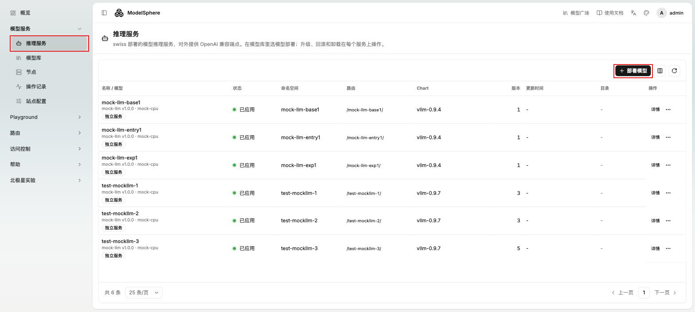

**第二步：在模型库搜索 `GLM-5.3-Flash`，打开模型卡片。**

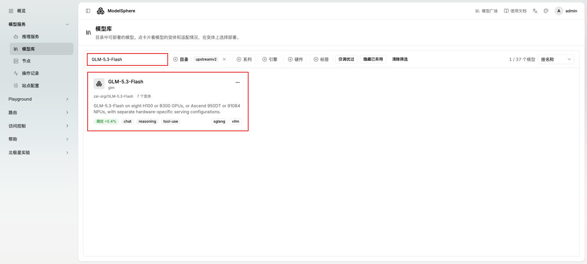

**第三步：选择 `vllm-tp8-910b4-baseline`，点击「部署」。** 这是单节点、8 卡 TP=8 的昇腾 910B4 配方。使用前核对快照中的权重、引擎和资源配置，并确认对应版本的引擎镜像已按第 04 节单独推入本地仓库。

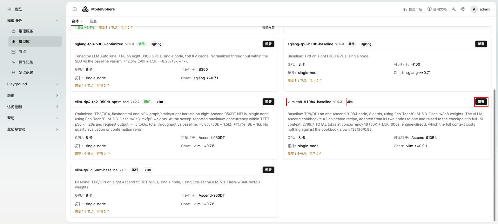

_图注：截图中的配方版本为 1.0.2；本文前面下载与推送命令对应的 [910B4 配方](https://github.com/modelsphere/model-catalog/blob/4b8b3a177be8a54be4cf4f6e91f9245d2b1a28d8/models/glm-5.3-flash/vllm-tp8-910b4-baseline.yaml)为 1.0.3。实际操作时，应选择与离线物料一致的版本，并检查目标节点是否满足资源要求。_

该配方配置了 1M 级最大上下文长度，实际可同时承载的并发与上下文组合还取决于显存 KV 缓存余量与运行负载。

### 配置服务、预览计划并设置四副本

**第四步：填写基本信息。** 模型与变体会自动带入，服务名使用 `glm-5-3-flash`，命名空间填 `models`，同时启用自动创建命名空间和发布路由。服务名会用于 Helm release、路由与 SLO 配置，请在创建前确认命名。

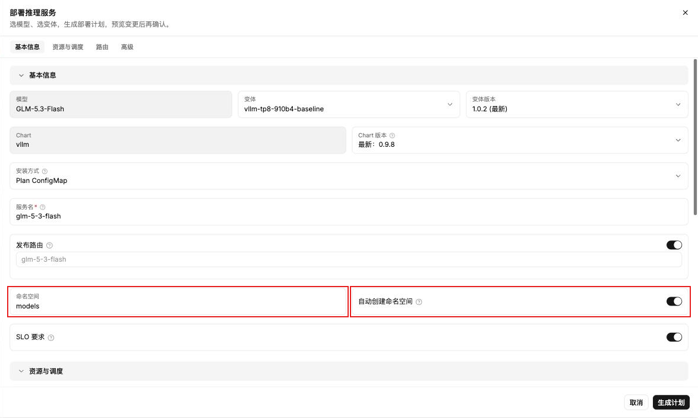

**第五步：在「资源与调度」中选择 `Ascend-910B4`。** 确认识别到匹配节点，且具备 8 张可分配 NPU 及足够的 CPU、内存。

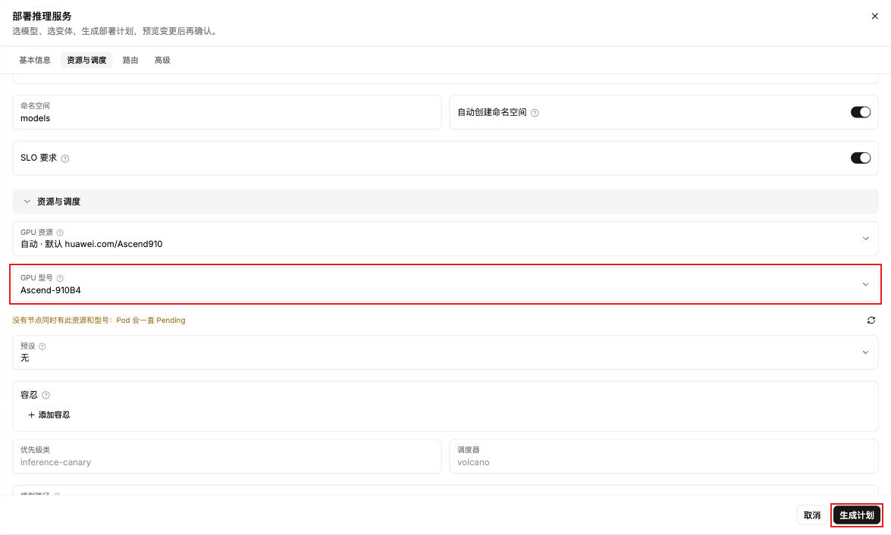

_图注：界面保留「GPU」字段名称，本文实际调度的是昇腾 NPU。若出现资源不足提示，可结合节点标签、控制面污点和当前资源占用排查。_

**第六步：点击「生成计划」，核对预览内容后点击「确认部署」。** 提交前确认引擎镜像来自本地仓库、权重挂载路径与节点目录一致。

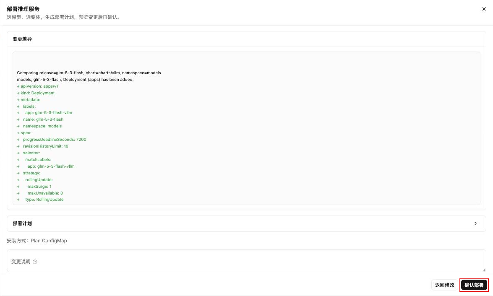

**第七步：在自动弹出的 SLO 面板设置副本数。** 在 `Bounds` 行将类型选为 `replica`，最少与最多都填 `4`，保存后按四副本目标运行。每个副本申请 8 张 NPU，在本篇四个可调度节点上各落位一个副本。

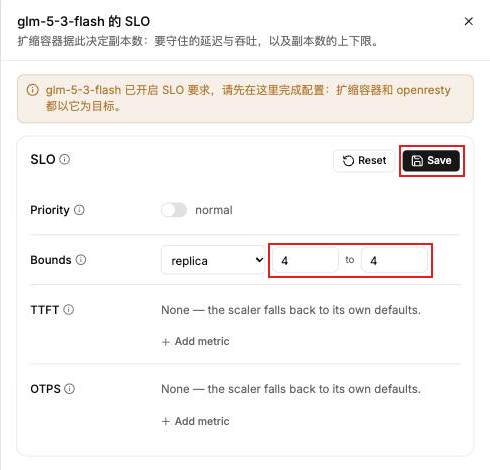

_图注：这里使用固定四副本。TTFT 与 OTPS 保持默认项，后续如需按延迟或吞吐目标调整，可另行配置对应指标。_

确认后，控制台会从集群内目录读取配方、改写本地引擎镜像地址，生成部署计划并通过 Helm 安装，整个过程在内网完成，不访问外部网络。随后各副本从节点本地目录加载权重并完成引擎初始化。

### 等待四个副本就绪

可以在服务详情页观察「安装进度」和「实例」分布，也可以在服务器 1 上通过命令行查看 Pod 状态：

```bash
kubectl -n models get pods -o wide -w
```

本篇的验收目标是：**实例就绪达到 `4/4`，四个副本分别调度到四台节点上，且服务路由已接入网关。** 具体加载耗时取决于磁盘读取、主机内存页缓存、引擎初始化与图编译过程。

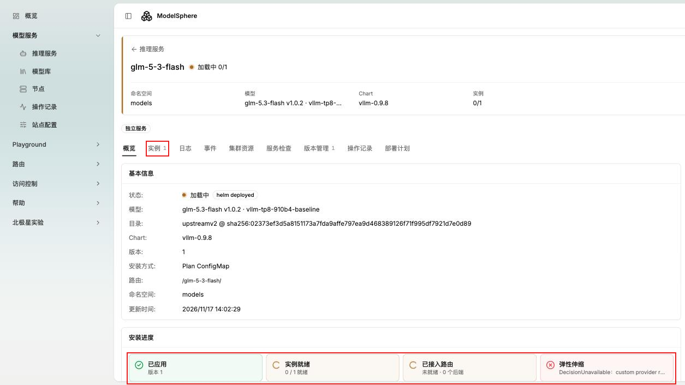

_图注：演示截图停留在「加载中 0/1」并显示伸缩异常，用于说明状态入口；实际部署时若出现异常，应结合实例、事件和日志排查处理后再进入调用验证。_

## 08 从统一入口发一次真实请求

四个副本就绪后，下一步是从网关入口发一次真实请求，验证网关路由与模型推理链路是否正常。

在服务详情页切换到「服务检查」，先点击 `Check service` 检查网关路由，再在 `Health check` 区域点击 `Send request`，通过实际入口发送请求并查看模型回答。

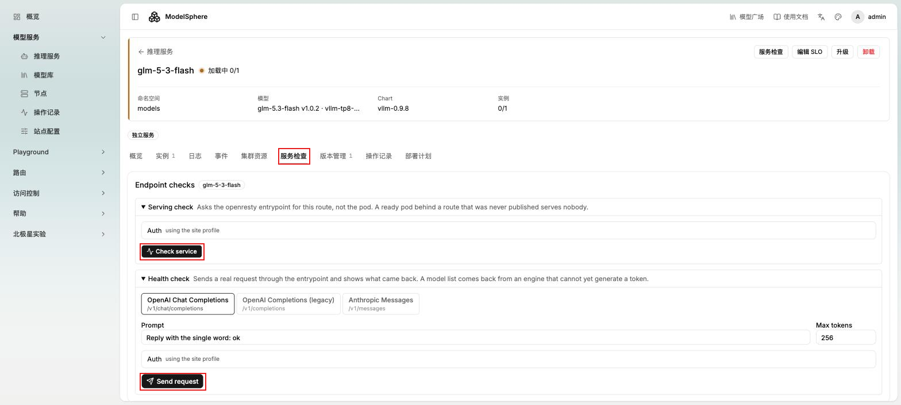

也可以在控制台左侧进入「Playground → 对话」，选择已就绪的 `glm-5-3-flash` 直接交互测试。

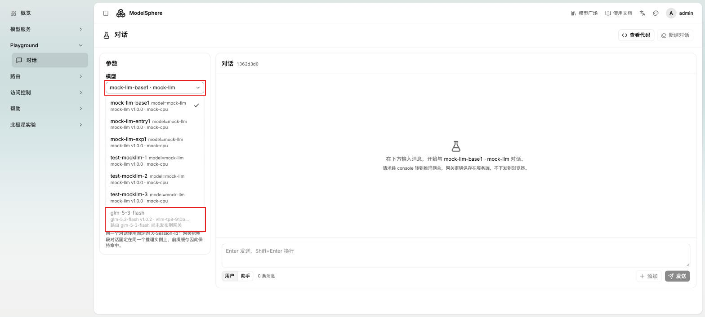

_图注：演示截图中 GLM 项尚未发布到网关，因此呈置灰状态；待服务就绪并接入路由后即可正常选择。_

需要对接业务应用或命令行验证时，可在服务详情页「概览」底部的「访问」区域直接复制服务地址与请求示例：

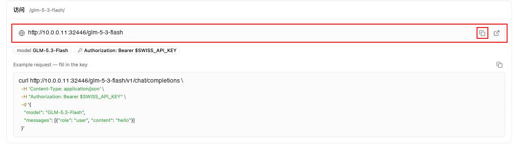

以上图中的地址为例，命令行调用方式如下（执行前替换为控制台显示的实际地址）：

```bash
curl http://10.0.0.11:32446/glm-5-3-flash/v1/chat/completions \
  -H 'Content-Type: application/json' \
  -d '{"model":"GLM-5.3-Flash","messages":[{"role":"user","content":"17 乘以 19 等于多少？只回答数字。"}],"max_tokens":64,"chat_template_kwargs":{"thinking":false}}'
```

本篇沿用未开启网关 API Key 鉴权的请求方式；若现场已启用鉴权，按实际配置的 Key 加上 `Authorization: Bearer` 请求头即可（页面示例中的 `$SWISS_API_KEY` 为占位符，配置方法见 [网关文档](https://github.com/modelsphere/modelsphere/blob/3c3e45d06d48aadaa9b770f7d01ddc5c42cb7eb2/docs/openresty.md)）。

检查响应中的 `content` 是否返回预期的 `323`，并结合服务检查确认正常，即说明模型服务已可通过统一入口正常调用。之后可将支持 OpenAI 兼容接口的客户端或 SDK 的 `base_url` 指向该服务地址下的 `/v1`，继续验证自己的业务请求。

## 09 后续在控制台完成日常运维

模型服务上线后，后续的状态查看、扩缩容、参数升级、卸载及新模型部署，主要都在控制台中完成。

### 查看状态与调整副本数

在「推理服务」列表中可以查看已创建的服务及其部署信息，进入详情页可进一步核对就绪实例数和实际路由。

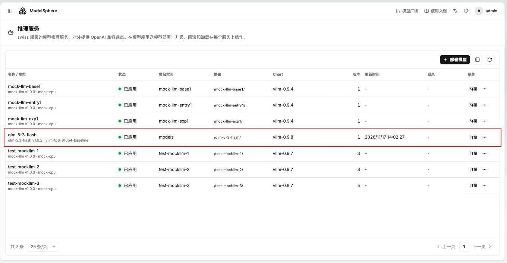

_图注：列表中的「已应用」表示部署配置已下发，服务是否可用仍需结合实例就绪状态和入口请求结果判断。_

「概览」页汇总了服务状态、资源分配和节点在线情况，便于从集群视角查看整体运行情况：

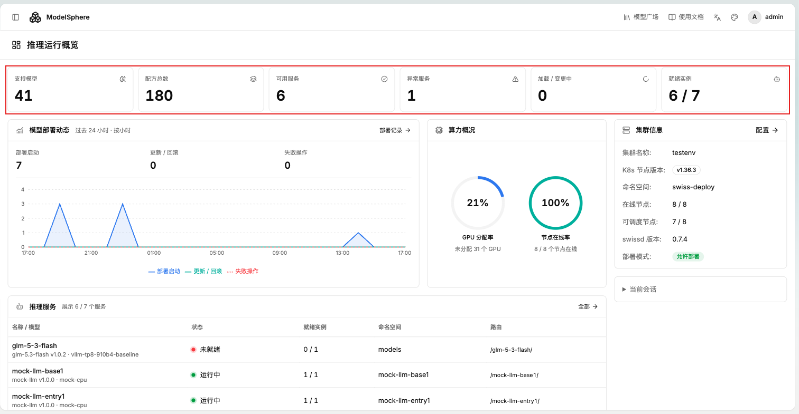

_图注：该图采集自 8 节点演示环境，当时 GLM 服务尚未就绪；图中的节点数、模型数与分配率为演示环境数据。_

服务详情页右上角集中提供「编辑 SLO」「升级」「卸载」三个操作入口：

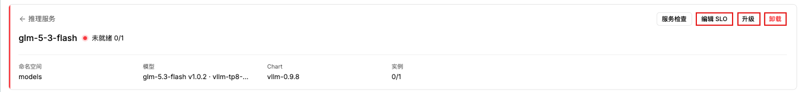

需要调整副本数时，点击「编辑 SLO」，在 `Bounds` 行修改副本上下界并保存。副本上限应结合集群内可调度节点数以及每副本 8 张 NPU 的资源需求设置。

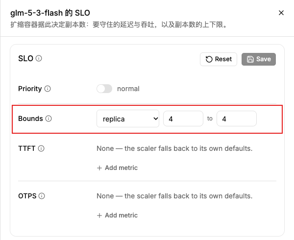

### 升级参数或卸载服务

点击「升级」，可切换变体版本，或调整资源、路由与高级参数，随后生成计划、预览变更并确认应用。离线环境下升级所需的 Helm chart 需提前纳入离线物料，对应版本的镜像也需事先导入本地仓库。

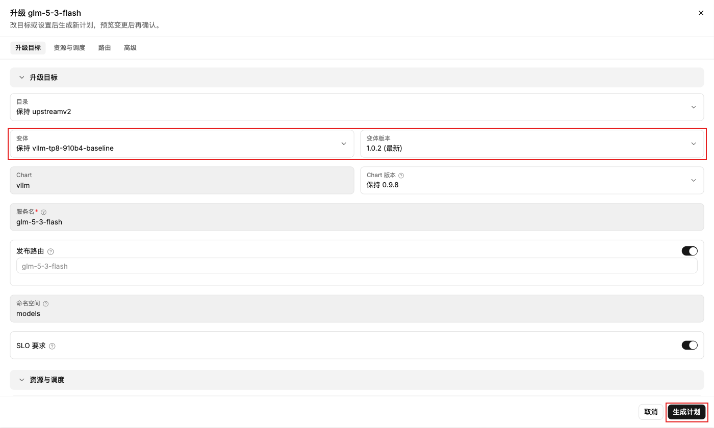

需要释放算力资源时，点击「卸载」并输入对应服务名确认。卸载会删除模型 Pod，后续重新部署时需要重新加载权重。

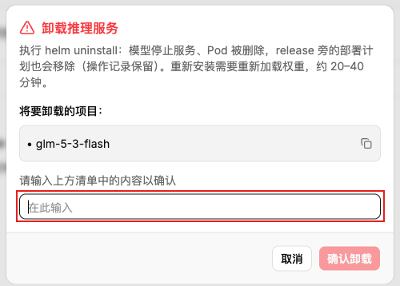

### 部署其他模型与补充离线物料

后续要在集群中部署其他模型时，可在「模型库」搜索目标模型，选择与硬件匹配的配方：

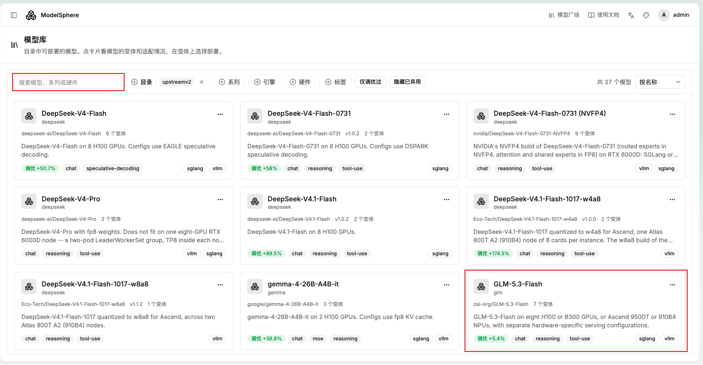

离线环境新增模型时，同样按两步流程准备物料：先在联网侧准备包含目标模型配方与引擎 chart 的目录快照（按需更新平台物料）；再根据目标配方的镜像字段，用 `crane pull` 单独下载模型引擎镜像，并准备匹配的权重文件。带入机房后，平台镜像通过 `make offline-load` 导入，引擎镜像通过 `crane push` 推到控制台对应的本地仓库路径，更新集群内目录服务后即可从控制台部署，让控制台读取的配方、本地仓库中的镜像与节点上的权重保持一致。

### 查看日志、监控与升级平台版本

排查模型运行异常时，服务详情页的「日志」标签支持按 Pod、容器和日志行数查看输出：

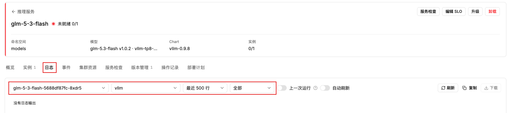

_图注：演示截图当时没有日志输出；实际遇到模型启动异常时，建议同时结合「事件」与实例状态一起定位。_

使用命令行排查时，可先列出 Pod，再将 `POD_NAME` 替换为实际名称：

```bash
kubectl -n models get pods -o wide
kubectl -n models logs POD_NAME
kubectl -n models describe pod POD_NAME
```

Grafana 位于 `monitoring` 命名空间。查看监控面板时，先查询集群中的实际 Service 名称，再通过 `kubectl port-forward` 将端口转发到本地访问。

需要升级 ModelSphere 平台本身时，在联网构建机按目标版本重新打包代码、平台组件镜像、chart 与目录快照，核对环境配置变化后带入机房。在服务器 1 导入平台镜像并应用对应配置；若同时更换模型引擎版本，再按第 03、04 节的分步命令单独补齐对应引擎镜像：

```bash
make offline-load REGISTRY=10.0.0.11:5000
make helm-apply ENV=offline-rewrite MODELS= SKIP_DEPS=1
```

## 10 遇到问题，沿依赖顺序逐层排查

离线部署涉及多个环节，遇到异常时建议按「节点环境 → 本地仓库 → 目录服务 → 模型实例 → 网关入口」的依赖顺序逐层检查：

| 常见现象                                 | 优先排查方向                                                                                                  |
| ---------------------------------------- | ------------------------------------------------------------------------------------------------------------- |
| Cilium 反复重启、节点持续处于 `NotReady` | 查看网络组件事件与日志，核对主机内核版本、cgroup v2 及 Cilium 的 API 地址配置                                 |
| Pod 报错提示 DNS 配置文件不存在          | 核对 kubelet 的 `resolvConf` 是否指向现场实际存在的 `/etc/resolv.conf`，并检查集群 ConfigMap 同步情况         |
| Pod 长时间卡在 `ContainerCreating`       | 查看 Pod 事件，检查 pause 镜像地址、本地镜像仓库访问和容器运行时状态                                          |
| 拉取镜像报 HTTP 响应给 HTTPS 客户端      | 确认对应节点是否已执行 `setup-offline-node` 配置本地 HTTP 仓库访问                                            |
| `kubeadm init` 预检报控制面镜像缺失      | 核对 `kubeadm`、配置文件中的 Kubernetes 版本与已导入仓库的镜像版本是否匹配                                    |
| Pod 出现 `ImagePullBackOff`              | 检查具体镜像引用、摘要和本地仓库路径是否存在，并确认目录快照与镜像清单匹配                                    |
| 节点上报的可分配 NPU 数量为 0            | 检查主机驱动、昇腾容器运行时、设备插件状态与节点上的 `workerselector` 标签                                    |
| 控制台「模型库」为空                     | 检查 `catalogMirror` 是否启用、`catalogSnapshot` 是否为有效绝对路径，以及目录服务的 `/status.json` 返回       |
| 未达成四副本目标或 Pod 持续 `Pending`    | 查看 Pod 事件中的 NPU、CPU、内存、节点亲和与污点条件；本篇四机拓扑还需检查 `ascend-11` 的控制面污点是否已移除 |
| 模型 Pod 启动后报找不到权重              | 核对四台服务器的权重目录内容、权限，以及 `swiss.modelPathTemplate` 展开后的路径是否一致                       |
| 实例已就绪，但请求未通过                 | 检查「服务检查」中的网关路由、后端端点状态，以及现场网关 API Key 配置                                         |
| 节点 `INTERNAL-IP` 与集群网络地址不符    | 多网卡环境下核对 kubelet 的节点 IP 选择，按实际集群通信网卡配置 `--node-ip`                                   |

如果在联网打包阶段脚本提示存在缺项，先确认缺失镜像属于哪个组件：若本次启用的组件或目标模型配方缺少 arm64 镜像，需要调整版本或组件开关后重新准备物料；若脚本跳过的是本次未使用的组件，对照物料清单确认不影响后续安装即可继续。

## 从这套离线配置开始

走到这里，机房内已搭建起本地镜像仓库、Kubernetes 集群与 ModelSphere 控制台。完成四副本就绪与入口检查后，即可通过统一地址调用 GLM-5.3-Flash，并在控制台中继续查看状态、调整副本和管理版本。

想在自己的昇腾环境中动手部署，可以先打开下面这份操作说明，对照准备节点、离线物料和模型权重：

👉 **昇腾离线部署说明**：[ModelSphere 910B4 K8s 部署流程](https://github.com/modelsphere/modelsphere/blob/3c3e45d06d48aadaa9b770f7d01ddc5c42cb7eb2/docs/offline-ascend-walkthrough.md)

👉 **更多配置细节**：[离线安装](https://github.com/modelsphere/modelsphere/blob/3c3e45d06d48aadaa9b770f7d01ddc5c42cb7eb2/docs/offline-install.md) · [昇腾节点准备](https://github.com/modelsphere/modelsphere/blob/3c3e45d06d48aadaa9b770f7d01ddc5c42cb7eb2/docs/add-ascend-node.md) · [控制台操作](https://github.com/modelsphere/modelsphere/blob/3c3e45d06d48aadaa9b770f7d01ddc5c42cb7eb2/docs/console.md)

部署过程中如果有新的发现，欢迎到 [ModelSphere GitHub 仓库](https://github.com/modelsphere/modelsphere)提 Issue 交流。带上硬件环境、代码版本、离线包记录和关键日志，会更方便一起定位问题。如果这篇教程对你有帮助，也欢迎顺手给 **ModelSphere 点个 Star ⭐**，支持我们继续补充更多模型与硬件的部署方案。
