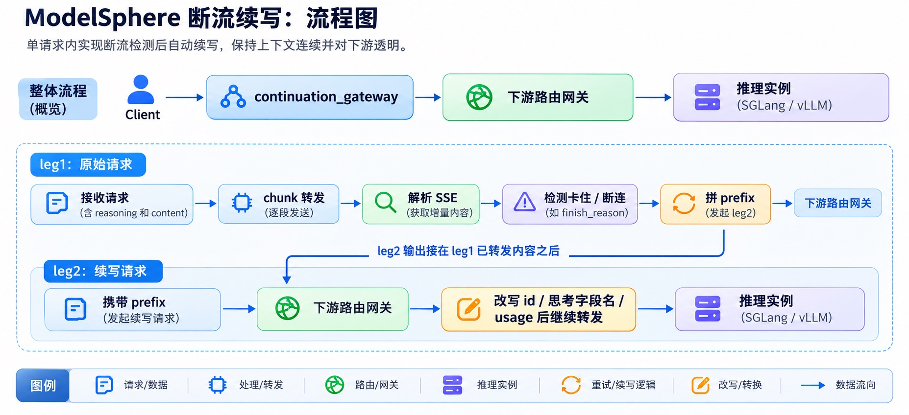

## 背景

线上跑过大模型推理服务的同学,大概都遇到过这种场景：一个长回复流到一半,推理实例 OOM 了、被调度走了、连接被 reset 了,或者更隐蔽的——进程还活着,但不再吐 token。客户端拿到的是一段被截断、没有 `finish_reason` 的回复。常规处理只有一个：整体重试。已经生成的几千个 token\(尤其是长思考模型的 reasoning\)全部白费,用户还要从头再等一遍。ModelSphere 的核心功能之一即为支持断流续写：它位于客户端和 OpenAI 兼容的推理服务\(SGLang / vLLM\)之间,在检测到流中途卡住或断连时,自动发起一次续写请求,把已经吐给客户端的内容当作 assistant 前缀,让模型接着往下生成。客户端看到的,仍然是一条连续、完整的流。

---

### 一、整体架构：有状态的编排层,而不是透明代理

#### 1\.1 部署位置

客户端 → 上游入口层\(鉴权/限流\) → continuation_gateway → 下游路由网关 → 推理实例\(SGLang / vLLM\)

网关只和"下游路由网关"这一个 URL 打交道,不维护实例列表和健康状态——选哪个实例、避开哪个故障实例,是路由层的事。续写请求默认也发往同一个下游地址,所以它大概率会被路由到一个健康的实例上。也可以通过 `CONTINUATION_URL` 把续写单独导向另一个集群\(比如首发走 vLLM,续写走 SGLang\)。

#### 1\.2 两条腿

我们把一次请求在网关内部拆成最多两条"腿"：

- **leg1**：客户端原始请求对应的下游流式响应。网关逐 chunk 转发,同时增量解析 SSE,累积已经发出去的 reasoning 和 content。

- **leg2**：leg1 没说完就结束时,网关主动发起的续写请求。它的输出被改写后,接在 leg1 已转发的内容后面。



注意：**这是一个单请求内有状态、跨请求无状态的服务**。续写需要记住"已经转发了什么"、解析 SSE 语义、主动发起额外请求、原地改写 usage,所以它不可能是透明的字节转发;但所有状态都活在单个请求的协程里,副本之间什么都不共享,可以水平扩展,不需要粘性会话。

#### 1\.3 怎么判断"流没说完"

这里有两个容易想当然的地方。

**第一,不能用 `[DONE]` 判断。** 开了 `stream_options.include_usage` 后,`finish_reason` chunk 之后还有一条纯 usage chunk,再之后才是 `[DONE]`。在这三步中任意一步之后断开,内容其实都已经生成完了。所以我们的判据是"**是否见过带 `finish_reason` 的 chunk**"。

**第二,idle 超时不等于"该动手了"。** 触发信号有三类：逐 chunk 的 idle 超时\(只在收到过至少一个 chunk 之后才计时,每个 chunk 重置,所以不会和首 token 排队延迟混淆\)、下游连接异常、干净 EOF 而没见过 `finish_reason`。但 idle 超时只有同时满足下面三条才会让 leg1 停下：

- 还没出现过 tool_call \(这是由于推理引擎不支持此情形的续写，后文将会提到\)

- 已经攒到可恢复的 reasoning 或 content

- 续写开关是开的

不满足时,网关继续等,行为等同于没有这层网关。原因很朴素：如果为了"检测"主动掐断一条其实还活着的连接,客户端会平白被断流而什么都救不回,比没有网关更糟。真正的断连/EOF 则无论什么状态都会结束读取,因为已经没有字节可读了。

#### 1\.4 几条贯穿始终的设计原则

- **网关层编排,不改引擎。** 这是整个项目的前提

- **保守优先,拿不准就透传。** 任何一项判断条件不满足,都退化为与没有网关时完全一致的行为：不主动挂断、不吞异常、不改写响应。

- **单次续写,最多两条腿。** leg2 自己再失败,不发第三条腿,按现状收尾,效果上不比没有网关更差。这也让 usage 修正公式可以假设"恰好两条腿"。

- **网关自身不能成为故障点。** 续写阶段的任何意外错误只记日志、不外抛,已经发给客户端的内容不受影响。

- **对客户端无感。** 整条流里 `id`、思考字段名前后一致;续写救回的部分也计入 usage;续写请求的 `max_tokens` 扣掉已经生成的部分,不会超出原预算。

---

### 二、续写请求的构造思路

#### 2\.1 基本思路：把已吐出的内容变成一条"没写完的 assistant 消息"（chat\-continue路径）

大模型是自回归的。要让它"接着写",本质上就是让它看到的 prompt 末尾,恰好是已经写出来的那部分内容,而且**不要**在后面补上"这一轮结束"的标记。

OpenAI 兼容接口里,SGLang 和 vLLM 都支持一对参数来做这件事：

```JSON
{
  "messages": [
    ...原始 messages...,
    {"role": "assistant", "content": "<已经吐出的前缀>"}
  ],
  "continue_final_message": true,
  "add_generation_prompt": false,
  "stream": true,
  "stream_options": {"include_usage": true}
}
```

- `continue_final_message: true`：渲染 chat template 时,最后一条 assistant 消息不闭合\(不加 end\-of\-turn\),模型从它的末尾继续。

- `add_generation_prompt: false`：不要再追加一个新的"assistant 开始"提示,否则模型会认为这是一个全新的回答,而不是在续写。

- 其余参数\(`temperature`、`tools` 等\)继承自原始请求。

这就是我们项目内对于大多数续写场景采用的续写思路，我们称为 **chat\-continue** 路径。

#### 2\.2 前缀怎么拼

带思考的模型,assistant 消息里有 reasoning 和 content 两部分,不同模型家族用不同的控制符把它们包起来。网关按部署所服务的真实模型\(由项目的环境变量`CONTINUATION_MODEL`控制,不是请求里的 `model` 字段——后者可以被任意命名\)分派到各自的 builder。我们构造的核心思想主要以续写触发时已获取部分是否已经获取了content chunk内容分为两种情形：`thinking-partial` 和 `content-done`。

默认的通用格式：

```
有 content(思考已闭合, content-done):  <think>{reasoning}</think>{content}
无 content(可能仍在思考, thinking-partial): <think>{reasoning}
```

某些特殊的模型需要我们通过参考其chat template构造方式以及试验，构建出一套它自己的控制符，例如我们采用的Kimi\-K3控制符如下：

```
有 content:  <|open|>think<|sep|>{reasoning}<|close|>think<|sep|><|open|>response<|sep|>{content}
无 content:  <|open|>think<|sep|>{reasoning}
```

这里面有一个我们很在意的取舍：**content 为空时,不闭合 think 标签。**

网关看到 content 为空、reasoning 非空,并不能确定模型是"还在想"还是"刚好想完、还没来得及吐第一个 content"。两种误判的代价是不对称的：

- 如果强行闭合,但模型其实没想完 → 模型的推理被截断,这是**不可逆**的错误;

- 如果不闭合,但模型其实已经想完 → 模型接着吐一个闭合标签再转入回答,这对模型来说是**自然的续写**。

两害相权取其轻：不闭合,把"要不要结束思考"的决定权还给模型。

#### 2\.3 content\-done 时要关掉思考

当 content 已经开始,说明思考阶段早就结束了。这时续写请求会在客户端原有的 `chat_template_kwargs` 上合并一个"关思考"开关,避免模型在续写时又重新开一段思考。

开关的 key 因模型而异：Qwen3\.6 的模板读的是 `enable_thinking`,而其他模型\(Kimi\-K3、GLM\-5\.3、DeepSeek\-V4\-Flash 等\)用 `thinking`。我们**每个模型只发一个 key**——有的模型收到不认识的开关,会把 reasoning 漏进 content，这类细节目前只能通过不断试验改进。

#### 2\.4 预算、id 与 usage：让客户端"无感"

构造出请求只是一半,让 leg2 的响应"看起来像 leg1 的延续"是另一半。

**max_tokens 扣减。** 推理引擎不知道这是"接着上一条腿续的","max_tokens"对它而言是"这次请求"的预算。不扣减的话,每续写一次就等于送模型一份全新预算。所以：

```
剩余预算 = 原始预算 - 已恢复的 reasoning+content 估算 token 数
```

只改客户端**实际传过**的字段\(`max_tokens` 和 `max_completion_tokens` 都传了就都改\);剩余预算 ≤ 0 就不再续写;客户端什么都没传\(意味着不限制\),我们也不凭空添加默认值。

**id 与字段名对齐。** 下游会给 leg2 分配新的 completion id,网关把每一行里的 `id` 改写回 leg1 的值——多数 OpenAI 兼容客户端依赖"一个流里只有一个 id"的假设。同理,SGLang 的思考字段叫 `reasoning_content`,vLLM 叫 `reasoning`,leg2 可能被路由到另一种引擎,网关会把字段名统一成 leg1 用的那个。

**usage 修正。** leg1 因为连接中断永远不会上报 usage;leg2 上报的只是"这条腿自己生成了多少",不含被救回的前缀。直接转发,客户看到的 `completion_tokens` 会异常小。我们的做法是：

```
completion_tokens = leg2 上报值 + 已恢复 reasoning 的估算 + 已恢复 content 的估算
tokens 估算      = ceil(CJK 字符数 / 1.6 + 其它字符数 / 4.0)
```

被救回部分用字符数估算,而不依赖下游的 `/v1/tokenize`——因为这会增加集群算力压力而且更重要的是某些模型的该接口可能会报错走不通。这里的原则是"**只做加法,不追求绝对精确**"：宁可小幅偏差,也不引入"完全测错"的风险。多模态请求是例外——图片、音频、视频没有字符可数,估算会严重偏小,所以改用 leg2 真实分词的 `prompt_tokens` 减去前缀文本的估算值。

#### 2\.5 兜底路径：chat\-continue 在 vLLM 上完全走不通时的 render\-generate 路径

这条路径属于是优先级较低的兜底方案，网关的默认选择始终是上面的 chat\-continue,而且遇到问题时,我们首先想的是怎么调整消息构造让 chat\-continue 跑通。只有当 vLLM 上的某个模型,其渲染器根本不认 `continue_final_message`，无论怎么调整都不可能续写时,才会考虑这条路径，目前只有个别组合标记为需要使用。

之所以把它优先级排在后面,是因为它的代价明显更高：依赖 vLLM 较新的 `--enable-scale-out` 功能\(默认关闭\),要求续写地址以及中间的 router 同时转发四个接口,一次续写要多走几步调用,网关里要处理的细节也多得多\(见 2\.7\)。

这条路径的思路是：既然引擎的渲染器帮不了我们渲染"续写 prompt",就在 **token 层**自己拼。续写腿依次调用同一个续写地址上的四个接口：

1. **`/v1/chat/completions/render`**：用客户端的**原始请求**\(包括 `chat_template_kwargs`、`tools`\)渲染出 prompt 的 token id。此时 prompt 末尾已经打开\(或已经关闭\)了思考通道,网关根据末尾的 token 判断属于哪种情况,而不是靠"reasoning 是不是空"去推断。

2. **`v1/tokenize`**：把已经发给客户端的 reasoning/content 拼成前缀文本,编码成 token id,接在 prompt 后面。注意这个前缀**不带开头标签**——它就是"模型接着 generation prompt 本来会写出的原始文本"。

3. **`/inference/v1/generate`**：token 进、token 出,流式返回,不做任何解析。

4. **`/v1/chat/completions/derender`**：把生成的 token id 还原成 OpenAI 格式的 chunk,reasoning / content / tool_calls 的拆分由服务端的 parser 完成。

#### 2\.6 为什么不直接用 `/v1/completions`

绕开 chat template 的另一个办法是调 `/v1/completions`,直接传 token 或文本。但它返回的是原始文本,没有 reasoning / content / tool_calls 的区分。要还原成客户端期望的 chat 流,网关就得自己为每个模型实现 reasoning parser 和 tool\-call parser,还要处理流式场景下标记被切开、tool call 参数逐步到达等细节——相当于在续写网关内重复实现一遍vllm parser，工程上不现实。

而 derender 接口等于把 vLLM 服务端那套输出解析逻辑\(parser \+ 流式状态\)单独打包了出来：网关只传 token id 和 `stream_state`,就能拿到标准 chunk,解析结果和普通 chat 请求同源,不用在网关里重复造轮子。

这套接口依赖 vLLM 的 `--enable-scale-out`\(较新、默认关闭\)。它的设计初衷是把预处理/输出解析与纯 GPU 生成拆开部署;对我们来说,网关扮演的恰好是那个"前端"。**前提是续写地址必须同时暴露这四个接口,中间如果有 router,也要转发它们。**

#### 2\.7 render\-generate工程化的问题和解决方案

**derender 的平方级开销与聚合。** generate 每个引擎步一个 SSE chunk,里面只有几个 token。而每次调用 derender,服务端都会新建 parser 并**重放此前全部输出 token**,请求体里还带着整个 prompt 的 token id。逐 chunk 调用的话,总开销随输出长度**平方**增长。所以网关每累计 `DERENDER_BATCH_CHUNKS`\(默认 8\)个 chunk 才调用一次,遇到带 `finish_reason` 的结束 chunk 时把剩余部分一次送出。代价是客户端看到的输出更"成块",但内容和顺序不受影响。

**模型特异性的处理依然存在。** 和 chat\-continue 一样,render\-generate 也会遇到模型特异性的问题。generate 接口生成的 chunk 通常只有几个 token,而不同模型的控制标记、推理标记的组成方式各不相同,有的标记可能恰好被切在两个 chunk 之间;此时 derender 一侧的解码与 parser 对"标记只来了一半"的处理,不一定能和网关的分批方式对得上,处理不当就会让半截标记漏进 reasoning 或 content,而且一旦发给客户端就撤不回来。所以网关在送出每一批之前,要针对具体模型检查批尾的状态,必要时把尾部的几个 token 顺延到下一批再送。换句话说,这条路径虽然绕开了 chat template,但**请求的构造和输出的后处理依然因模型而异**,整体比 chat\-continue 路径更复杂,这也是我们把它放在最后的原因之一。

**出口拆分。** 一批 token 可能同时跨 reasoning、content、tool_calls,parser 会把它们合并成一个 delta;但标准流式 chat 接口里,一个 chunk 一次只带一种内容。所以网关按 reasoning → content → tool_calls 的顺序拆成多个 chunk 再写给客户端,每个 tool call 单独一个,`finish_reason` 只放在最后一个上。

**usage。** 和 2\.4 节 chat\-continue 用的是同一套公式。唯一的差别在 `reasoning_tokens`：这条路径的 generate 和 derender 都不上报,所以改按 derender 输出的 reasoning 文本估算。

### 三、不同模型具体怎么构造续写——需要适配

上面说的 chat\-continue "默认构造",已经能覆盖大多数模型。但"能覆盖大多数"不等于"能覆盖全部",而**哪些模型会在哪里出问题,只有真的跑过才知道**。

举一个我们踩到的典型例子。

#### 3\.1 案例：Qwen3\.6\-35B\-A3B \+ vLLM,content\-done 直接 400 拒绝

默认构造下,我们把 reasoning 和 content 拼成一整个字符串,放进最后一条 assistant 消息的 `content`：

```json
{ "role": "assistant", "content": "<think>{reasoning}</think>{content}" }
```

这在 SGLang 上都没问题。但在 **vLLM \+ Qwen3\.6\-35B\-A3B** 上,**content\-done** 这种情况会被引擎直接以 **HTTP 400** 拒绝。

原因要从 `continue_final_message` 的实现说起：vLLM 在渲染完 chat template 之后,会校验"最后一条消息的 content 是否**原样**出现在渲染结果里",以此确定从哪里截断、接着往下写。而 Qwen3\.6 的 chat template 会把 content 中的 `<think>R</think>C` 拆开重排——在 `<think>` 之后、`</think>` 前后补换行,并去掉首尾空白。于是我们传进去的那整串字符串,在渲染后的 prompt 里已经**找不到原样的一份**了,校验失败,400。

#### 3\.2 修正：拆成结构化消息

我们通过实验确认的解法是：在这个组合的 content\-done 场景下,改发 **reasoning / content 分开的结构化消息**：

```json
{ "role": "assistant", "reasoning": "{reasoning}", "content": "{content}" }
```

这样模板会按 reasoning 渲染思考部分,而 `content` 里只剩正文部分——正文部分会**原样**出现在渲染结果中,而且截断位置恰好就在正文部分的末尾,校验通过,续写正常。

#### 3\.3 这件事说明了什么

这个例子想表达的不是"Qwen 有个坑",而是一个更一般的事实：

> **"模型 × 引擎"的每一个组合,chat template、continue_final_message 的校验方式、reasoning parser、思考开关,都可能不一样。续写策略必须按组合去验证,不能按经验推断。**

所以我们的续写网关实际上同时在做两件事：一个网关,以及一套**经过验证的续写策略集合**。目前 README 里有部分我们验证过的兼容矩阵信息，没在表里的模型,网关会按通用格式处理并在启动时打 warning——可能能用,但有待验证。我们仍在持续扩充兼容模型和迭代续写策略,**接下来也会加入对信创卡环境的验证**。

---

### 四、目前不能支持的：以及我们为什么选择不去"硬支持"

#### 4\.1 json_object / json_schema 结构化输出

当请求带了 `response_format: json_object` 或 `json_schema` 时,被 guided decoding 约束的 JSON 内容和普通 content 一样混在 content chunk 里流出来,**没有任何独立信号**能把它们区分开。要识别"这段 content 其实是被约束着的"再决定怎么重建前缀,复杂度不值得。

好在这一条从原始请求本身就能判断,所以网关在转发之前就前置排除,直接透传。

#### 4\.2 tool_call 内容已经出现之后

`continue_final_message` 的标准语义里,`tool_calls` 字段表示"这一轮已经说完了、该 tool 角色回复了"。**没有"tool_call 还在生成中"的状态位。** 所以一个已经流给客户端的半截 tool_call,在 leg2 里是接不上的。要真正支持,需要引擎侧提供这个状态位,这不是网关层能解决的。

默认策略因此是：一旦 leg1 上出现过 tool_call chunk,就不再续写,按现状收尾。

#### 4\.3 可选的绕开方案：`BUFFER_TOOL_CALLS`

我们提供了一个**可配置**的网关层绕开方式：把"tool_call 已经流给客户端"这个不可续写的状态,让它**永远不发生**。

- leg1 上从第一个带 `tool_calls` 的行起,这一行及之后的所有行都暂存在网关内存里,不转发;

- 收到 `finish_reason`\(tool_call 全部吐完\)或 `[DONE]` 时,整批一次性放行;

- 暂存期间 leg1 卡住/断连：**整批丢弃**,按第一个 tool_call 之前的 thinking\-partial / content\-done 状态做普通续写。leg2 会重新生成,可能又是一个 tool_call。因为客户端从来没收到过 tool_call,所以不存在"续不上"的状态。

它是有代价的：tool_call 的参数不再逐 chunk 流式到达,而是在 tool_call 完成后一次性到达;暂存内容在网关内存里一直停留到 tool_call 结束\(目前没有字节上限\)。它还以"续写开关打开"为前提——续写本身被关掉的话,暂存不会换来任何补救,只会白白延迟。所以默认关闭,由部署方按场景取舍。

#### 4\.4 其它边界

- 客户端自己带了 `continue_final_message` 的请求：不叠加续写。

- 第一个 chunk 之前的故障、没有任何可恢复内容的故障：不属于续写,原样上抛,是否重试由上层决定。

- leg2 自己再失败：不发第三条腿。

- 续写内容在断点处的语义是否绝对连贯：没有自动化保证,只能抽检。usage 也是估算值。

### 五、小结与后续

回到最开始的问题：推理实例崩了,流式回复还能接着写吗?

- 能,但需要一个**有状态的编排层**来监测、记账、构造请求、对齐响应;

- "怎么构造续写请求"远不是一个固定公式——**同一套默认构造,在不同的模型 × 引擎组合下会因为 chat template、校验、parser 的差异而失效**,需要逐组合实验;

- 只有在 chat\-continue 在 vLLM 上完全走不通\(渲染器不认 `continue_final_message`\)时,才兜底退到 token 层,用 render → tokenize → generate → derender 把续写做完;

- 对做不到的场景,保持保守透传策略。

接下来我们会继续：

- 补充更多"模型 × 引擎"组合的验证,并把结论沉淀进兼容矩阵;

- **加入对信创卡环境的验证**;

- 持续完善端到端测试，故障注入流程。

项目已经以 Apache\-2\.0 协议开源，欢迎使用

> 仓库：`github.com/modelsphere/continuation_gateway`
