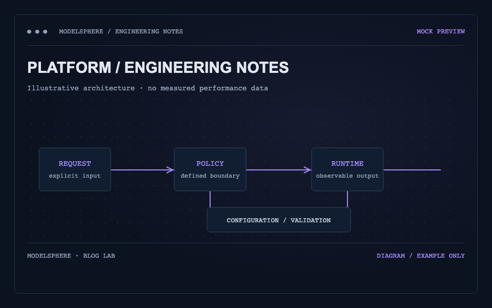

## 先从一条请求开始

这是一篇 **Mock 博客文章**，用于检查推荐文章、正文目录、图片、代码和相关文章。这里的协作流程是教学示意，不是产品能力验证，也不包含实测成绩。

在一个假设的推理服务中，请求会经过接入、路由和引擎。阅读架构时，可以先把每一层的输入、输出和失败路径列出来。



## 明确组件的责任边界

### 接入与路由

接入层处理协议和请求边界，路由层选择目标实例。具体实现及限制需要根据对应版本的公开资料核对。

### 引擎与控制面

引擎执行生成任务；控制面维护期望状态。两者如何协作，应当由真实实现来说明。

| 阅读问题     | 需要查阅的材料     |
| ------------ | ------------------ |
| 谁接收请求？ | 接入配置与协议说明 |
| 谁选择实例？ | 路由策略与失败行为 |
| 谁恢复服务？ | 健康检查与控制流程 |

## 用配置记录上下文

下面仅为排版示例，不能直接部署。

```yaml
# Mock configuration — for layout verification only
service:
  name: example-inference
  routing: explicit-policy
  recovery: application-defined
```

:::note
所有正式技术结论都需要对应版本、适用范围与可核查的来源。
:::

## 继续阅读

可以阅读[测评条件示例](/blog/example-blog-benchmark)，也可以[返回博客列表](/blog)。
