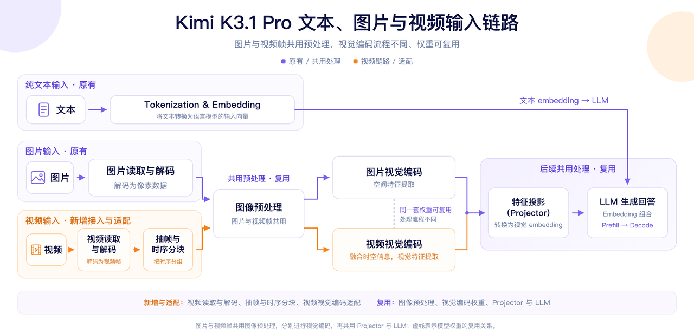
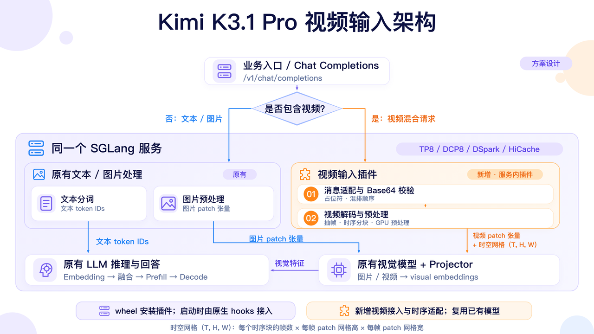
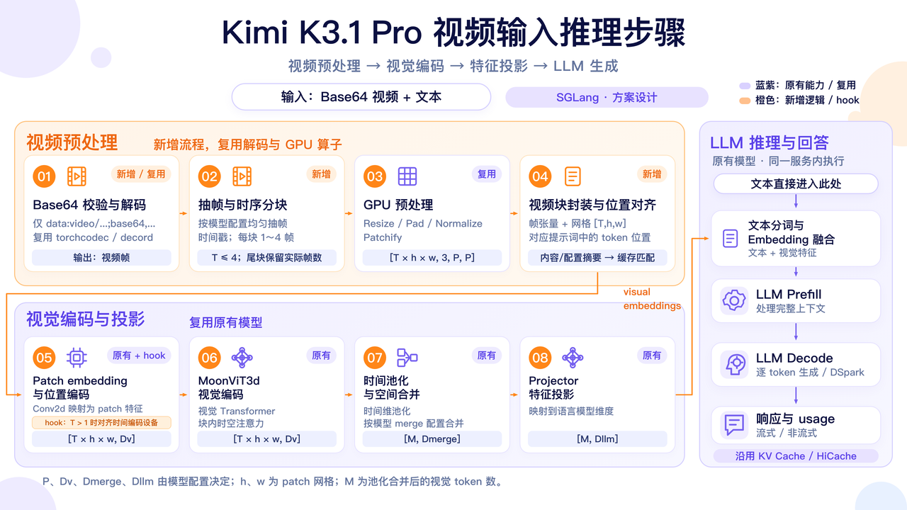
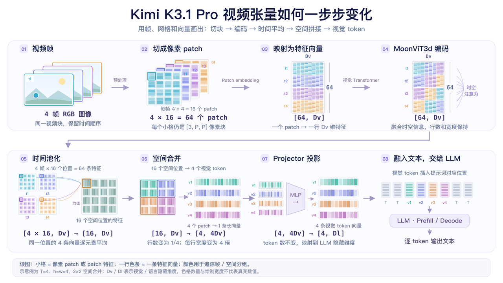

模域 ModelSphere 已将 Kimi-K3.1-Pro 视频输入能力接入 SGLang，并提供可在平台启用的一键部署配方。本文从视频接入、时序编码到视觉 token，拆解这条链路如何复用现有模型，以及如何通过 ModelSphere 部署带视频能力的推理服务。

Kimi-K3.1-Pro 的官方 API 已支持视频输入，但对于希望自行部署模型、在本地业务中使用这项能力的团队，还需要把视频接入与现有推理服务连接起来。

在本文适配的开源模型与 SGLang 版本中，原有链路已经支持文本和图片，视频读取、抽帧、时序分块以及多帧推理适配仍有缺口。那么在直接使用这一版本部署时，视频输入能力与官方 API 之间存在落差。

ModelSphere 为此补齐了从请求接收到视觉特征融合的处理链路，并将适配工作封装为独立插件。接入插件后，文本、图片和视频可以进入同一个本地推理服务，复用已有视觉模型、特征投影模块和 LLM 来完成回答生成。

这项能力也已收录进 ModelSphere 的 Kimi-K3.1-Pro 视频输入配方。完成 ModelSphere 安装，可以在生产环境中直接启用配方，进行一键部署。

**ModelSphere 将模型接入、时序处理和推理框架适配沉淀为开源组件与部署配方，让本地生产服务接通与官方 API 对应的视频输入能力。**

下面是这套视频输入方案的具体实现：

## 01 复用现有模型，补齐视频输入链路

要理解这次扩展，可以先看文本、图片和视频最终如何进入 LLM。

文本经过分词和 Embedding，变成语言模型使用的向量。图片先经过读取与解码，得到像素数据；视频先读取、解码为图像帧，再按配置抽帧并进行时序分块，保留采样帧的时间顺序。

图片像素与组织好的视频帧随后进入共用的图像预处理流程，完成缩放、补边、归一化和 patch 切分，再分别进入对应的视觉编码流程。Projector——特征投影模块，将编码后的视觉特征映射到语言模型的隐藏维度。

最后，文本向量与视觉向量按照提示词中的位置组合，形成统一的输入序列。



_图 1：文本、图片与视频输入的处理关系。图片与视频帧共用图像预处理；视觉编码复用同一套权重，具体处理流程有所不同。_

现有图片链路已经具备图像预处理、视觉编码、特征投影和回答生成能力。接入视频时，可以复用这些组件，但需要增加三个环节：

- **读取视频并解码为帧：**将请求中的视频内容还原为可处理的图像数据。
- **抽帧并按时序分块：**保留采样帧之间的时间顺序，为视觉编码提供多帧组织方式。
- **适配视频视觉编码：**在复用权重的基础上，处理多帧输入和时间位置信息。

图片与视频共用同一套视觉模型权重，各自采用匹配输入形态的处理流程：图片侧提取空间特征，视频侧进一步融合帧间的时间信息。

## 02 用插件接入，同一服务处理混合输入

为了让新增逻辑能够独立安装和更新，我们将扩展封装为 Python 包，以 wheel 形式安装，并在服务启动时通过 SGLang 的 hook 机制接入运行流程。

这种方式将扩展代码与框架源码分开维护，通过运行时 hook 接入已有模型。视频请求进入新增处理逻辑，纯文本与图片请求沿用原有处理路径。



_图 2：插件接入同一 SGLang 服务。橙色为新增视频接入与适配，蓝紫色为原有处理能力及模型。图中的 TP8、DCP8、DSpark、HiCache 展示原链路的示意配置；本文一键部署配方的具体镜像与运行参数以配方页为准。_

插件主要处理三类适配：

- **消息与位置适配：**接收并校验 Base64 视频，保留文本、图片和视频在消息中的混排顺序，让各段视觉特征对应到提示词中正确的位置。
- **多帧计算适配：**组织视频块，复用图像预处理算子，并对齐多帧时间位置编码的设备与数据类型，接入原有视觉编码流程。
- **缓存标识与用量统计：**结合媒体内容及处理配置生成用于缓存匹配的标识，并将视频对应的 token 正确归类到用量统计中。

独立插件使视频扩展可以与框架分开维护和更新。这套适配覆盖消息处理、多帧编码、特征位置对齐、缓存标识及用量统计，将模型能力接入到服务的完整请求流程中。部署时采用匹配的 SGLang 版本，框架升级后重新检查 hook 接口兼容性。

插件代码与版本要求：

[https://github.com/modelsphere/kimi-video](https://github.com/modelsphere/kimi-video)

## 03 从视频字节到可输入 LLM

下面这张图展示了完整推理流程。视频先经过接入与预处理，再进入视觉模型和 Projector，最终与文本一起交给 LLM。



_图 3：视频预处理、视觉编码、特征投影与回答生成的完整链路。标注“新增”的是扩展逻辑，解码器、GPU 算子及原有模型按对应环节复用。_

### 3.1 先把视频组织成时序块

Base64 解码先将请求内容还原为视频字节，随后由视频解码器读取图像帧。这是两个不同步骤：前者处理传输格式，后者处理视频内容。

插件按配置均匀采样，再按时间顺序分块。当前实现单块最多容纳 4 帧，整个视频可以包含多个块。尾块按实际帧数进入后续处理，保持采样结果与时间组织一致。

接下来，各帧复用已有图像预处理流程，完成缩放、补边、归一化和 patch 切分。patch 可以理解为图像上的一个小区域。视频侧还需要控制处理预算，并保证同一块内各帧使用一致的空间网格。

处理后的帧张量会连同时间与空间网格一起封装，并与提示词中预留的视觉位置对齐。这里的网格 `[T, h, w]`，分别记录块内帧数、每帧 patch 网格的高度和宽度。

### 3.2 再编码时空信息，压缩视觉序列

进入视觉模型后，像素 patch 先经过 Patch embedding，映射为特征向量，并加入空间与时间位置信息。

随后，MoonViT3d 通过块内时空注意力，让各位置的特征融合空间与时间上下文。编码完成后，再进行时间池化与空间合并，减少后续交给语言模型的视觉 token 数量。

Projector 将合并后的特征映射到 LLM 的隐藏维度。服务把这些视觉 embedding 填入提示词对应位置，与文本 embedding 一起完成 Prefill，再由 Decode 逐 token 生成回答。

**这条流程也决定了首 token 延迟的构成：第一个输出 token 返回前，服务需要完成全部采样帧的处理，以及包含这些视觉信息的 LLM Prefill。**

服务在完成采样帧处理和 Prefill 后，可以逐 token 流式返回回答。首 token 等待时间包含这些输入处理开销；其他条件相近时，更多采样帧或更高处理分辨率通常会增加视觉计算量与输入规模，需要结合业务目标设置处理预算。

## 04 视觉 token 如何形成？

流程图说明了每一步做什么，张量形状则能解释数据如何变化。

假设一个视频块包含 4 帧，每帧划分为 4 × 4 个 patch，采用 2 × 2 空间合并。这些数字仅用于示意；实际帧数、空间网格和特征维度由输入与配置决定。

图中 `Dv` 表示视觉隐藏维度，`Dl` 表示语言模型隐藏维度，`P` 是像素 patch 的边长。

下面按逻辑步骤展开形状变化，便于理解；具体实现可以合并部分操作，采用相应的中间张量布局。



_图 4：示意条件为 T=4、h=w=4、2×2 空间合并。色块用于追踪帧与空间分组；实际特征维度与数值由模型和输入决定。_

### 4.1 64 个像素 patch，变成 64 条特征向量

每帧 16 个 patch，4 帧共有 64 个。每个 RGB 像素 patch 的形状为 `3, P, P`，合起来得到：

```text
64, 3, P, P
```

经过 Patch embedding，每个 patch 映射为一条 Dv 维特征向量，得到：

```text
64, Dv
```

可以把它理解为一张表：每行对应一个 patch，每列是特征的一个维度。MoonViT3d 编码后，表仍是 64 行、每行 Dv 维，但每条向量已经融合了块内时空上下文。

### 4.2 时间取平均，空间做拼接

时间池化对同一空间位置的多帧编码特征取平均。示例中，4 帧对应的 64 条特征压缩为 16 条：

```text
[64, Dv] → [16, Dv]
```

参与平均的每条特征已经融合块内时空上下文。时间池化进一步汇总同一空间位置的多帧表示，得到该位置的编码特征。

空间合并则将相邻 2 × 2 个位置的特征沿通道维拼接。4 条向量拼成一条，行数减少，每行变长：

```text
[16, Dv] → [4, 4Dv]
```

### 4.3 投影到语言模型维度，放回提示词位置

Projector 将这 4 条长向量映射到 LLM 的隐藏维度：

```text
[4, 4Dv] → [4, Dl]
```

这一步改变向量维度，token 数保持为 4。最终，它们被放到提示词对应位置，与文本及协议标记共同构成形状为 `[L, Dl]` 的输入序列，`L` 表示总序列长度。

在这个示例中，一个包含 4 帧、每帧 4 × 4 patch 的视频块，经过时间池化和 2 × 2 空间合并后，得到 4 条视觉 token。整段视频的视觉 token 数由各块处理结果累积而成，随采样帧数、空间网格与合并配置变化。

## 05 接入前，明确输入与资源边界

当前插件接收 `data:video/<format>;base64,<payload>` 形式的视频内容，**处理范围为视频画面，音轨暂未纳入解析流程。**文本、图片和视频可以混合输入，视频长度、采样密度与单帧分辨率需要共同纳入预算。

接入时，建议重点确认三件事：

- **部署环境是否匹配：**ModelSphere 视频输入配方已收录对应的引擎镜像、插件启用项与运行参数。通过平台部署时，按配方检查硬件和模型目录；自行集成插件时，按源码文档确认 Python、SGLang 及解码依赖版本。
- **输入预算是否符合业务：**更多帧能提供更多采样画面，也会增加处理成本；更高分辨率会影响 patch 数量与视觉计算。应根据业务关心的画面细节与时间变化设置采样和预算，再验证实际效果。
- **混合负载下的服务表现是否可接受：**纯文本与图片请求沿用原有处理逻辑，并与视频请求共享 CPU、GPU、显存和传输资源。接入视频后，应通过目标负载验证整体吞吐、各类请求的延迟和资源占用，为混合业务配置合适的容量。

## 06 开始使用

从官方 API 提供视频输入，到开源模型在本地生产服务中接通这项能力，需要完成视频接入、时序组织、视觉编码与推理服务适配。ModelSphere 已将这些工程工作沉淀为开源插件，并进一步封装成可在平台启用的部署配方。

**安装 ModelSphere 后，准备好配方要求的算力与模型权重，即可启用 Kimi-K3.1-Pro 视频输入配方，一键部署带视频能力的推理服务。**配方已包含对应引擎镜像、插件启用配置和运行参数，支持文本、图片与视频混合输入。

使用路径如下：

1. 在已安装的 ModelSphere 中打开 Kimi-K3.1-Pro／sglang-video 配方。
2. 按配方要求确认算力、模型权重目录与运行配置。当前配方适配单机 8 张 B300，并使用 DFLASH 草稿模型，需一并准备对应权重。
3. 启用配方部署服务，待实例就绪后，通过服务入口提交视频与文本请求，验证业务效果。

👉 **一键部署支持视频输入的 Kimi-K3.1-Pro 服务：**

[https://ourl.cn/2jeRpf](https://ourl.cn/2jeRpf)

👉 **视频输入插件源码：**

[https://github.com/modelsphere/kimi-video](https://github.com/modelsphere/kimi-video)

👉 **ModelSphere GitHub：**

[https://github.com/modelsphere/modelsphere](https://github.com/modelsphere/modelsphere)

欢迎通过 Issue 或 PR 反馈实际场景。附上插件与 SGLang 版本、采样配置、媒体尺寸和时长，以及对应日志，有助于定位输入处理、视觉编码或推理阶段的问题。

## 拓展资料

Kimi 官方视觉输入文档：

[https://ourl.cn/2h32gc](https://ourl.cn/2h32gc)

SGLang 视觉模型实现：

[https://ourl.cn/9GmV3L](https://ourl.cn/9GmV3L)

## 关于我们

模域 ModelSphere 是由范式智能（PHANCY）与睿思智联（RiseUnion）共同发起，面向大模型推理的开源生产级基础设施社区，打通异构算力适配、云原生集群调度与极限性能调优，让大模型从“实验室能跑”直通“生产好用”。
